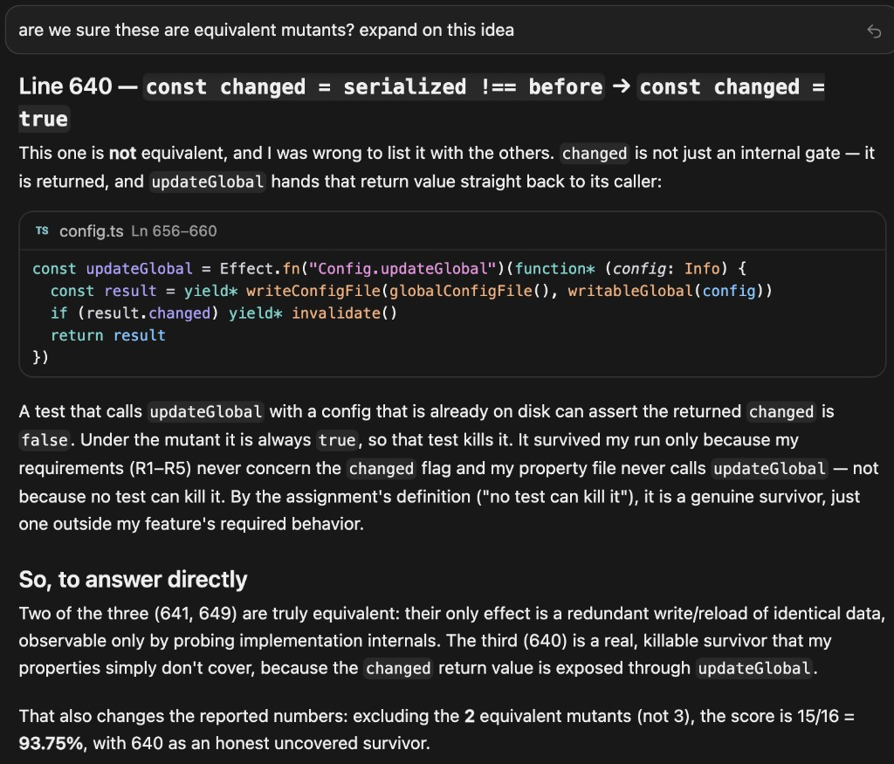
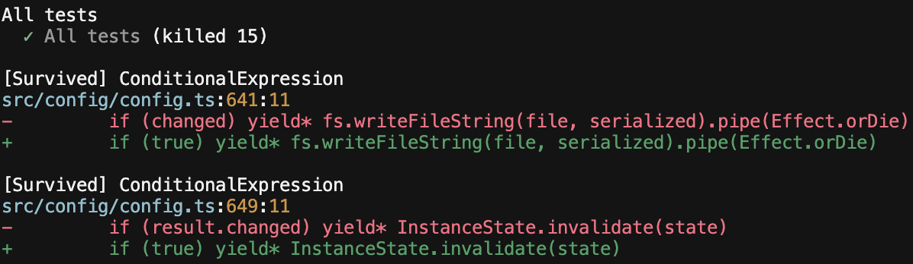

# Traceability: Parker Merritt (pmerritt)

**Target feature:** Allow changing permissions in the UI — `packages/tui/src/component/dialog-permissions.tsx`, `packages/opencode/src/config/config.ts`, `packages/opencode/test/config/config.test.ts`

## Requirements

| ID  | Interview evidence                                                    | Requirement                                                                                        | Acceptance Criteria                                                                                                                                                      | Changed in P4? | Property (kind) | Test                                                                                                                                                                                                           | Mutants it kills |
| --- | --------------------------------------------------------------------- | -------------------------------------------------------------------------------------------------- | ------------------------------------------------------------------------------------------------------------------------------------------------------------------------ | -------------- | --------------- | -------------------------------------------------------------------------------------------------------------------------------------------------------------------------------------------------------------- | ---------------- |
| R1  | C-4: Keep the settings the same, yes.                                 | The config.json file needs to be saved upon change.                                                | If a user changes a setting in the UI, it needs to be reflected in the config.json file and saved even if the computer is immediately shut off without ending a session. | No             | Round-trip      | `permissions.property.test.ts`: "R1: an updated permission action persists through save and reload"                                                                                                            | none             |
| R2  | C-5: I should never see the pop-up, yeah.                             | If a permission is changed to deny, then the user should never see a pop-up asking for permission. | If the setting changes to Deny, config.json needs to update this setting and reset the rules for the LLM so the pop-up never shows.                                      | No             | Invariant       | `permissions.property.test.ts`: "R2: a tool set to deny evaluates to deny for every pattern"; "R2: a denied tool rejects with a denied error instead of asking"; "R2: an allowed tool resolves without asking" | H2, H3           |
| R3  | S-5: yes, revert the change                                           | If a setting is changed, it must be reversible.                                                    | If a user changes a setting from ask to deny, then clicking the setting two more times should cycle back to deny (because there are three total options for a setting).  | No             | Round-trip      | `permissions.property.test.ts`: "R3: reverting a changed permission restores the original action"                                                                                                              | none             |
| R4  | S-6: I'd say the json file should be the source of truth.             | The settings displayed in the UI should be the same as in the config.json file.                    | For all settings, the UI should display the exact permission properties as the config.json file.                                                                         | No             | NA              | Not implimented                                                                                                                                                                                                | none             |
| R5  | C-6: Yes, if they are universal, the settings should then be changed. | If a universal setting is changed, all sessions should update with this new permission.            | When a universal setting changes, all active sessions need to reload their permissions.                                                                                  | No             | Metamorphic     | `permissions.property.test.ts`: "R5: a universal permission change is visible to every later load"                                                                                                             | H1, H5           |

Properties written or suggested by opencode or another AI tool: R1, R2, R3, R5 (drafted with AI assistance, especially with respect to creating the temporary json files).

## Requirement changes

No change made - All requirements are feasible and implementable. They test two different properties, and ensure the settings do truly match the config.json file.

## Hand-written mutants

Predictions were recorded before `bun test test/config/permissions.property.test.ts` was run on each applied patch. Each patch was reverted before the next run.

| ID  | Requirement targeted | Change                                                                               | Predicted killer                                                 | Actual result                                                                                                                            |
| --- | -------------------- | ------------------------------------------------------------------------------------ | ---------------------------------------------------------------- | ---------------------------------------------------------------------------------------------------------------------------------------- |
| H1  | R1                   | config file is never reloaded on a change                                            | R5 - permission changes should reload globally upon a change     | Killed by R5. Counterexample ["ask", "deny"]: the reload still returned "ask".                                                           |
| H2  | R2                   | Forget to check if a rule is denied, so it is treated like it needs permission       | R2 - The user should not see the popup after changing it to deny | Survived. R2 never actually calls the function for denying the UI pop up as oppposed to it's theoretical evulation outside of the pop up |
| H3  | R2                   | Forget the when writing permissions, so permissions become "" instead of ""          | R2. The generator includes non-empty patterns like ""            | Killed by R2. Counterexample ["read", " "], but you cannot have empty permission strings.                                                |
| H4  | R4                   | Accidently return ask instead of allow for a permission if one doesn't already exist | None.                                                            | Survived.                                                                                                                                |
| H5  | R5                   | Don't write over existing global permissions                                         | R5 - All sessions should have the new changes updated            | Killed by R5. Counterexample ["ask","ask"], we got an undefined result                                                                   |

## Stryker comparison (seed 42)

Stryker did generated the "\*" to "" change, but nothing else. I think my idea of mutants were more related to bugs instead of mutants, as my code changes were made in context as opposed to Stryker changing conditionals and deleting code inside of curly braces.

I would not have thought of changing if conditions to true because that will not survive a code review, as no one should be writing "if true". However, this was helfpul to identify parts of the test suite that are not complete.

Stryker does not find changes made within context, such as remembering to reload the config file for all sessions after a setting is changed. Stryker did a better job at testing a volume of mutants, as handwritting all of those would be slow.

Baseline mutation score: 38.89% (7 of 18 killed, 11 survived).

After adding tests that (1) explictly ask for permission and (2) don't make any changes 86.67% (13 killed, 2 survived).

Excluding the 2 equivalent mutants below, the score is 100% (15 of 15).

The two equivalent mutants below both simply shortcut the evaluation if nothing is changed. However, if nothing is chagned, it simply rewrites the file identically as before, so it is equivalent behavior. It does add an extra step, but this extra step is fast (as the config file is not that large).

Equivalent Mutant 1:

-         if (changed) yield* fs.writeFileString(file, serialized).pipe(Effect.orDie)

*         if (true) yield* fs.writeFileString(file, serialized).pipe(Effect.orDie)

Equivalent Mutant 2:

-         if (result.changed) yield* InstanceState.invalidate(state)

*         if (true) yield* InstanceState.invalidate(state)

## Agent Failure Case



It let the this mutant fall through:

-           const changed = serialized !== before

*           const changed = true

While this does not effect the resulting config file, the return statment is a dictionary including the value of changed, so it incorrectly returns this value as true with this mutant. The property it was currently testing did not test the return result of something that made no changes, only that the config file did not change. The new version ensures that if nothing changes, the result returns false in permissions.property.test.ts lines 120-136:

```ts
// R1: "The config.json file needs to be saved upon change."
// Kind: round-trip
test("R1: rewriting an unchanged permission reports no change", () =>
  fc.assert(
    fc.asyncProperty(keyArb, actionArb, (key, action) =>
      runInProject((dir) =>
        Effect.gen(function* () {
          const config = ConfigParse.schema(ConfigV1.Info, { permission: { [key]: action } }, "test:config")
          yield* FSUtil.use.writeWithDirs(path.join(dir, "opencode.json"), JSON.stringify(config))
          yield* Config.Service.use((svc) => svc.updateGlobal(config))
          const rewrite = yield* Config.Service.use((svc) => svc.updateGlobal(config))
          expect(rewrite.changed).toBe(false)
        }).pipe(withGlobalConfigDir(dir)),
      ),
    ),
    RUNS,
  ))
```

Evidence it kills the mutant (only equivalent mutants are left):


