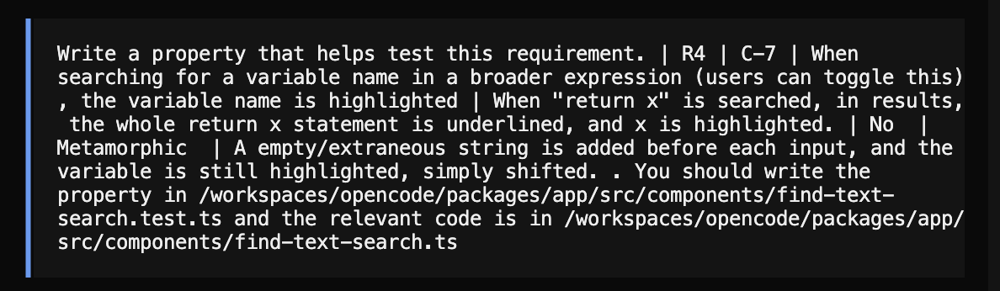
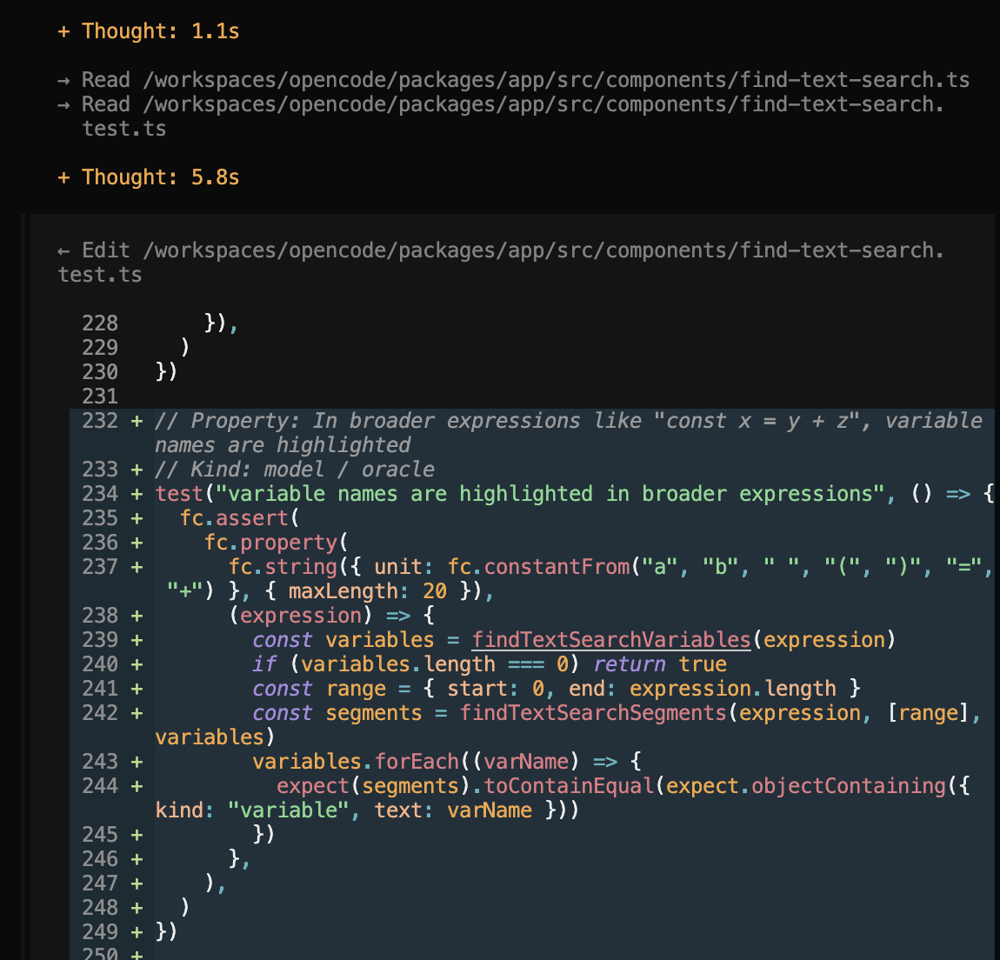
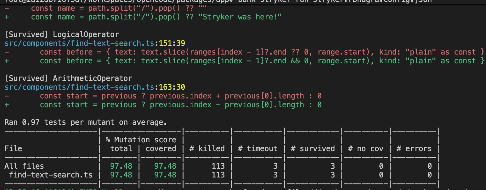
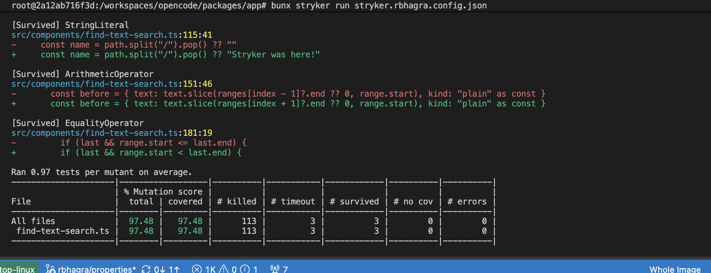

# Traceability: <Rohan  Bhagra> (<rbhagra>)

**Target feature:** <OpenCode Global Search, https://github.com/CMU-313/fall-26-opencode-chicken-parb/blob/main/packages/app/src/components/find-text-search.ts>

## Requirements

| ID | Interview evidence | Requirement | Acceptance Criteria | Changed in P4? | Property (kind) | Test |
|---|---|---|---|---|---|---|
| R1 | O-3 | Whitespace-only queries never trigger a search | for any string s, search(s) === (s.trim() !== ""). | Yes  | Invariant  | Search runs only when query has non-whitespace input
 R2 | S-1 | When a global search query returns no results, there should be a popup to say so | "Cars" run on the search API returns no results, UI displays "no results found," closest_search runner runs searches to find nearby hits, UI displays a search "car" button | Yes | Invariant | UI Dialog shows none iff API returns None  
| R3 | O-2, S-2 | Users should be able to search by programming language, only results that exist in that language should be returned | In a project where we have a.ts, b.python, c.txt with each having text "rotate", searching for "rotate" with python enabled only returns b.python | No | Oracle |  a language search equals the unfiltered search filtered by that language's extensions through standard means 
| R4 | C-7 | When searching for a variable name in a broader expression (users can toggle this), the variable name is highlighted | When "return x" is searched, in results, the whole return x statement is underlined, and x is highlighted. | No  | Metamorphic  | A empty/extraneous string is added before each input, and the variable is still highlighted, simply shifted. 
| R5 | C-4, S-4, O-4 | If results of a search are changed via git fetch, a UI element should should let users rerun search | "Import {poll}" is populated via git fetch. The UI should throw a "new results present" button, that allows users to rerun search | No  | Not included in the 4 properties.

Properties written or suggested by opencode or another AI tool: <Property for R1, Property for R4. After this section:  O-3, anything beyond the handwritten properties >

## Requirement changes

| ID | Original requirement (P3) | Revised requirement | Why it changed |
|---|---|---|---|
|R1 | When a query has multiple results, if there is one in the current package, it should be displayed first. |Whitespace-only queries never trigger a search|This is hard to test and there is not a reliable way to test what directory a user is in and accordingly verify what is returned first. |
|R2 | When a global search query returns no results, there should be a popup to say so, and a button that suggests a nearby search | When a global search query returns no results, there should be a popup to say so | This adds additional testing complexity and is non-determinisitc. 

## Hand-written mutants 

| ID | Requirement targeted | Change | Predicted killer | Actual result |
|---|---|---|---|---|
| H1 | R1 | `return query.trim().length > 0` to `return query.length > 0`, so the whitespace isn't removed before comparison | "Search runs only when query has non-whitespace input" | Killed by "a search runs exactly when the query has non-whitespace input" because we pass in a string with " ", and that returns len 1. |
| H2 | R3 | `return filterFindTextSearchResults(mapFindTextSearchResults(matches), languages)` changed to `return filterFindTextSearchResults(mapFindTextSearchResults(matches))`, silently dropping language filtering | "a language search equals the unfiltered search filtered by that language's extensions through standard means" | Killed by "R3: a language search equals the unfiltered search filtered by that language's extensions", all languages are returned |
| H3 | R2 | `if (dot <= 0) return` is changed to `if (dot < 0) return`, changing the extension a file like .py is treated as a file with no extension. | "UI Dialog shows none iff API returns None" | Survived, the generator doesn't create files that start with a dot. |
| H4 | R2 | `return filterFindTextSearchResults(mapFindTextSearchResults(matches), language)` changed to `filterFindTextSearchResults(mapFindTextSearchResults(matches), language).slice(0, -1)` | "UI Dialog shows none iff API returns None" | Killed by "R2: the dialog lists no results exactly when the API returns none", the last entry is dropped off, which in a result of size 1, incorrectly reports that nothing is found. |
| H5 | R4 | `const before = { text: text.slice(ranges[index - 1]?.end ?? 0, range.start), kind: "plain" as const }` to `const before = { text: index === 0 ? "" : text.slice(ranges[index - 1]?.end ?? 0, range.start), kind: "plain" as const }`, forcing the plain text before a match to be empty | "A empty/extraneous string is added before each input, and the variable is still highlighted, simply shifted." | Killed by "R4: prepending an unrelated line only shifts highlighted and underlined text", a newline character was failed to be recognized and mishifted the result. |

## Stryker comparison 

My overall mutation score was 62.18. Further analysis of this score is in the responses below.

1. Stryker did not generate mutants for H4 (did not change the arguments by removing, only reformatted them or added an additional mapping translation) or or H5 (only tested off by one). It did generate mutants for the remaining hand-written mutants. Stryker likely didn't generate mutants for H4 because removing an argument was not an obvious change to the code, and does not seem like a bug that can be reasonably introduced, as the function took 2 arguments. H5 did not have any matching mutants as the obvious change in that line of code is introducing an off-by-one error, rather than adding an additional comparison check, as that changes the core intent of the function.

2. Two stryker survivors that I didn't consider as plausible bugs was a conditional expression change and and a variable assignment change. The two mutants are as follows: 

 a) [Survived] ConditionalExpression
src/components/find-text-search.ts:159:7
-     if (!pattern) return [{ text, kind: "match" }]
+     if (false) return [{ text, kind: "match" }]
b) [Survived] MethodExpression
src/components/find-text-search.ts:93:47
-       const leading = match.lines.text.length - match.lines.text.trimStart().length
+       const leading = match.lines.text.length - match.lines.text.trimEnd().length

The first bug is unlikely to be one that a developer could make because the entire case logic is curropted in this mutant. A developer is unlikely to write a case that just checks falsehood, because this trivially will never run. The second bug is more plausible. Depending on the way the match string is constructed, it could make sense to trim and normalize from the end. 

3. The stryker approach obviously has more coverage by virtue of it being automated and hitting every major line of code. This helps increase the amount of things that are tested, and can provide a stronger garuntee of how well-written code is. However, a lot of the failing cases from Stryker are trivial, or unlikely to ever exist as a bug, meaning that the score is not particularly meaningful. Another drawback that manual mutants help adress is that the stryker approach does not garuntee to test the interesting cases in the function. As a developer, you can best understand the types of bugs you would make, so by manually writing mutants, you can fortify your code against similar errors that might've been made. 

# Equivalent mutants 
Mutant: Stryker #14 (StringLiteral)
Original line: const name = path.split("/").pop() ?? ""
Mutated line: ?? "Stryker was here!"
Justification: The fallback in this method can never run, so the mutation has no real effect on the operation of tis code .`path` is always a string, and `String.prototype.split` always returns an array with at least one element. Also, `split` returns an array with an empty string, so `pop()` always returns a string and it will never return undefined. 
`

We have no other equivalent mutants 

# Final mutation score 

Stryker: 114 killed / 116 (98.32%) - there were also 3 that timed out 

Equivalent mutants excluded: 114 killed / 115 (99.13%). 

## Agent failure case 

Exceprt of the opencode transcript with mutation written: 

    
This property is on line 218-236 of find-text-search.test.ts. It is an oracle property. 

The mutant it let survive had the original code: const start = previous ? previous.index + previous[0].length : 0

It is mutant 81 on line 163. 

The mutated code is: const start = previous ? previous.index - previous[0].length : 0

This property was too weak because it only checked that each variable (in an expression that contained two variables) appeared somewhere in the returned segment, and it did not check the match text near a variable segment. The positioning was not checked under a transformation, just the presence of the two vairables. In this specific mutation, the gap of text between matched variables was truncated incorrectly, and the property passed it off as a correct response because it only checked for presence.

Fix: 
// Property Opencode 4: In broader expressions like "const x = y + z", variable names are highlighted
// Kind: model / oracle
// this is written by opencode
// FIX: adding a round-trip check to ensure that joining the segments produce the original expression 
// FIX: moving maxLength inside the fc.string check to make sure that the char limit is properly applied. 
test("variable names are highlighted in broader expressions", () => {
  fc.assert(
    fc.property(
      fc.string({ unit: fc.constantFrom("a", "b", " ", "(", ")", "=", "+"), maxLength: 20 }),
      (expression) => {
        const variables = findTextSearchVariables(expression)
        const segments = findTextSearchSegments(expression, [{ start: 0, end: expression.length }], variables)
        expect(segments.map((segment) => segment.text).join("")).toBe(expression)
        expect(segments.every((segment) => segment.kind !== "plain")).toBe(true)
        expect(
          segments.filter((segment) => segment.kind === "variable").map((segment) => segment.text),
        ).toEqual(expression.match(/[\w$]+/g) ?? [])
      },
    ),
  )
})

Evidence mutant was killed:

Initial: 

Fixed: 

As can be observed, the specific mutant from the initial run is gone, as it has been killed by the fix. 

NOTE: I obtained another imporvement over this fixed version (as noted in the statistics for final mutation score) by adding an additional round-trip check. 